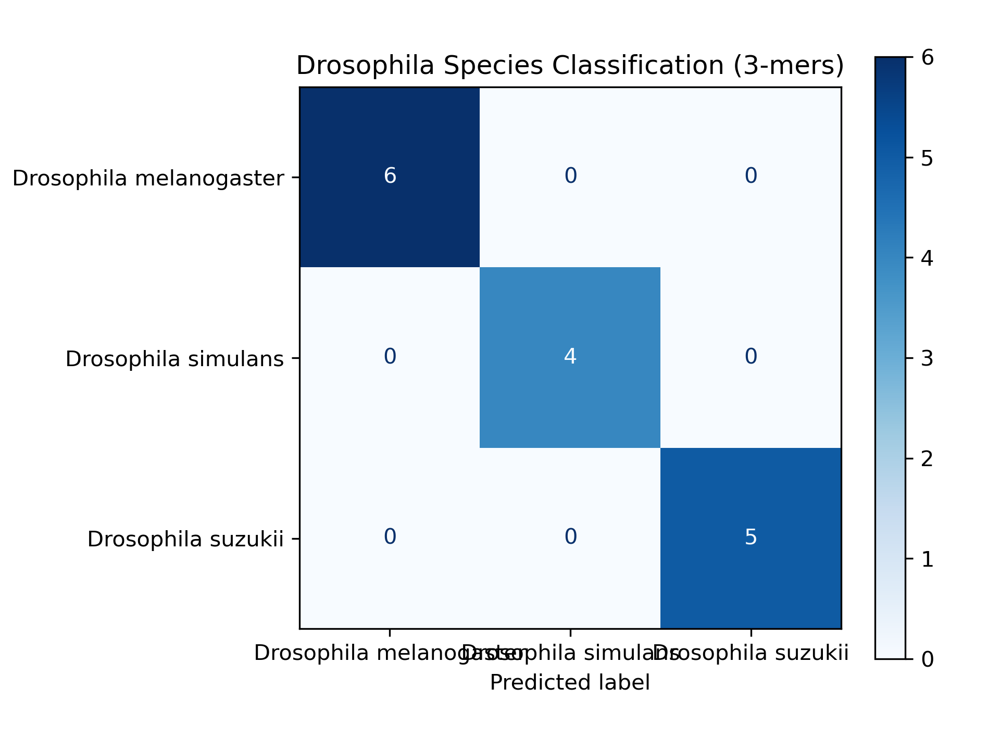

# Drosophila Species Classification Using COI K-mers

**Python | Biopython | scikit-learn | mitochondrial DNA barcoding**

A personal computational biology project evaluating whether short DNA
patterns (3-mers) can distinguish three *Drosophila* species using partial
mitochondrial cytochrome c oxidase subunit I (**COI/COX1**) sequences.

## Research question

**Can an interpretable, supervised machine-learning model distinguish
*D. melanogaster*, *D. simulans*, and *D. suzukii* using normalized DNA
3-mer frequencies from COI sequences?**

This project tests classification of **COI barcode fragments**, not arbitrary
nuclear or whole-genome DNA.

## Dataset

COI nucleotide records were obtained from the **NCBI Nucleotide/GenBank**
database. The quality-control report covers **84 sequences** (26
*D. melanogaster*, 29 *D. simulans*, and 29 *D. suzukii*). After a
preliminary cleaning procedure, the model used **58 sequences**:

| Species | Sequences modeled |
| --- | ---: |
| *D. melanogaster* | 22 |
| *D. simulans* | 16 |
| *D. suzukii* | 20 |
| **Total** | **58** |

Raw partial COI fragments were approximately **523–685 bp** long in the
cleaned collection. The dataset was filtered for exact duplicate sequence
strings and ambiguous nucleotides, with an additional manual exclusion for
records showing conflicting species assignments. See
`results/sequence_quality_report.csv` for the initial QC summary.

**Data provenance:** The accession IDs and original filenames are preserved
in `results/ncbi_accession_manifest.csv`.

## Analysis

1. **Quality control** (`inspect_dataset.py`) — Parse each FASTA record using Biopython; inspect
   accession, length, GC content, ambiguous bases, and exact duplicates.
2. **Cleaning** (same `inspect_dataset.py`) — Remove exact duplicate records, manually flagged conflicting
   species-label records, and sequences with ambiguous nucleotide characters.
3. **Alignment check (diagnostic)** — Perform local pairwise alignments in
   both orientations against one *D. melanogaster* COI reference to inspect
   overlap. **The alignment was not used to trim sequences for model input.**
4. **Feature extraction** — Convert each sequence into normalized frequencies
   of every possible 3-mer: **4³ = 64 numerical features**.
5. **Training** — Stratified 75/25 train/test split (`random_state=42`),
   followed by a `StandardScaler` -> `LogisticRegression` pipeline using
   balanced class weights.
6. **Evaluation** — Report held-out classification results, compare with a
   majority-class baseline, and perform stratified five-fold cross-validation.

## Results

| Evaluation | Result |
| --- | ---: |
| Held-out accuracy | **100% (15/15 sequences)** |
| Majority-class baseline, held-out | **40%** |
| Mean 5-fold CV accuracy | **98.33%** |
| Five-fold accuracy | **91.67%, 100%, 100%, 100%, 100%** |
| CV standard deviation | **0.0333 (fractional accuracy)** |



The confusion matrix contains 6 correct *D. melanogaster*, 4 correct
*D. simulans*, and 5 correct *D. suzukii* predictions, with no errors in this
particular 15-record holdout. Raw feature frequencies, QC outputs, and the
cross-validation score table are included in `results/`.

## Limitations

These results are **exploratory**, not evidence of validated performance on
independent biological samples.

- The dataset is small, particularly the held-out set (15 sequences).
- Exact duplicates were removed, but **near-identical** sequences and records
  from related isolates or studies may occur on opposite sides of a split.
  Conventional random splitting and five-fold CV do not prevent that.
- Partial COI sequences can have **different fragment boundaries**, so
  normalized k-mer frequencies may partly reflect which gene interval was
  sequenced. The pairwise alignment report is descriptive, not a completed
  shared-interval validation.
- A conflicting cross-species identical sequence was flagged in preprocessing;
  NCBI organism annotations were not independently validated by specimen.
- High performance on three known species does not imply generalization to
  unseen species, unrelated genes, or arbitrary genomic regions.

Possible extensions include grouped or sequence-similarity-aware evaluation,
comparable COI regions, additional independent samples, and exploration of
other k-mer sizes. These are **future work**, not analyses claimed here.

## Installation and reproduction

Python 3.10+ is recommended. From the project folder:

```bash
python3 -m venv .venv
source .venv/bin/activate
python3 -m pip install -r requirements.txt
```

**Option A: Using your existing FASTA folders.** Copy your original `data/`
(raw FASTA records) and `data_clean/` (58 retained FASTA records) into this
repository. Then run:

```bash
python3 classification_model.py
```

**Option B: Rebuild from NCBI accessions.** Requires internet access and an
email address that NCBI can use to contact you. The download utility is
provided for convenience and has **not been live-tested** in this packaged
version.

```bash
python3 download_ncbi_sequences.py --email your.email@example.org
python3 inspect_dataset.py
python3 align_sequences.py
python3 classification_model.py
```

If you rerun `inspect_dataset.py` after changing input files, first remove any old
`*.fasta` files from `data_clean/` to prevent stale records from remaining.
The cleaning section’s manually flagged exclusions reflect the original dataset and
may need revision if new source sequences are added. Outputs from these
scripts are written to the repository root; representative outputs from the
completed analysis are archived in `results/`.

The preliminary `examples/inspect_single_fasta.py` is included as the first
basic Biopython parsing exercise; it is not required to run the full model.

## Repository contents

```text
├── README.md
├── requirements.txt
├── download_ncbi_sequences.py    # Optional reconstruction of input FASTA files
├── inspect_dataset.py           # Combined QC and cleaning of FASTA data
├── align_sequences.py           # Diagnostic COI alignments
├── classification_model.py      # 3-mer logistic regression and validation
├── examples/
│   └── inspect_single_fasta.py
├── data/                         # Place raw NCBI FASTA files here
├── data_clean/                   # Place filtered FASTA files here
└── results/
    ├── ncbi_accession_manifest.csv
    ├── sequence_quality_report.csv
    ├── alignment_quality_report.csv
    ├── kmer_features.csv
    ├── cross_validation_scores.csv
    └── confusion_matrix.png
```

## Acknowledgments

Sequence accession records were retrieved from the
[NCBI Nucleotide database](https://www.ncbi.nlm.nih.gov/nucleotide/).
Classification was implemented using Biopython, pandas, and scikit-learn.

**Project type:** Self-directed learning / exploratory computational biology
portfolio project. No license has been selected for this repository.